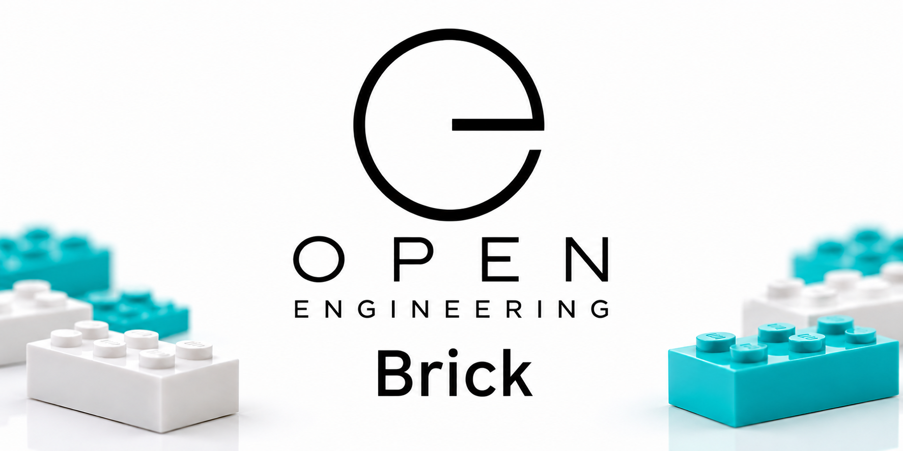
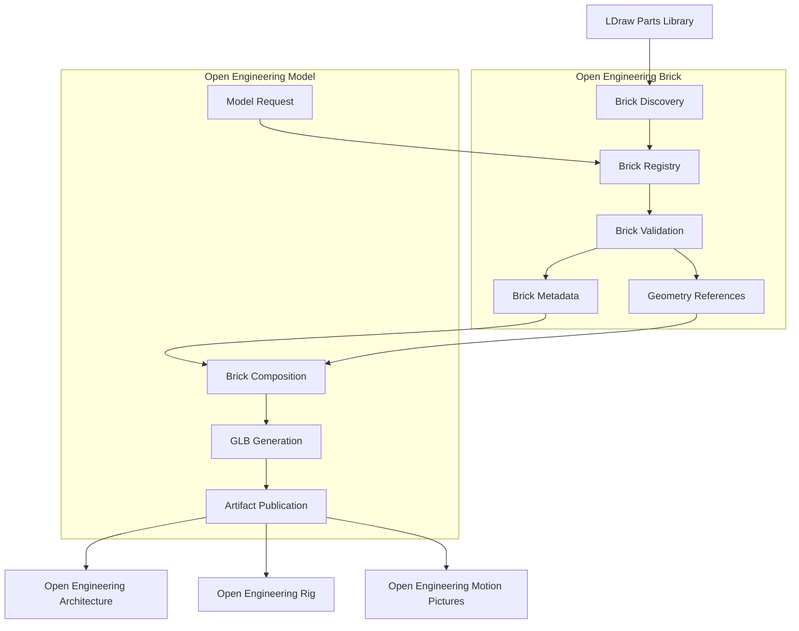
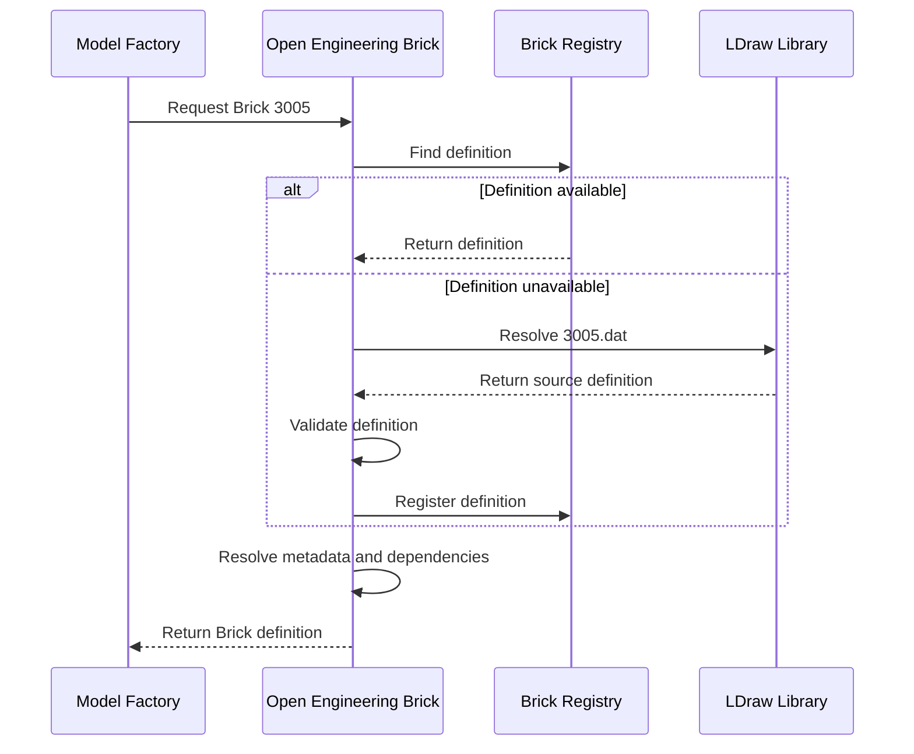
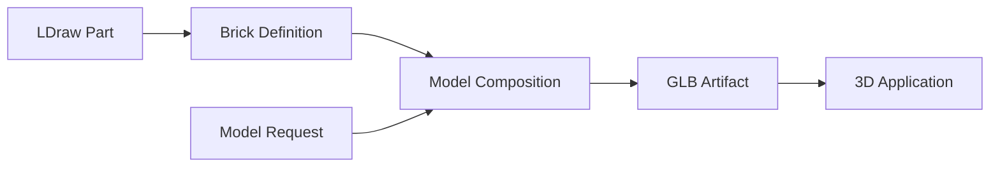
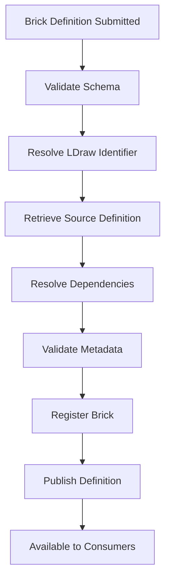

<div align="center">

# Open Engineering Brick



### Every engineering model begins with a building block.

**Discover · Define · Validate · Reuse**

</div>

---

## Welcome

**Open Engineering Brick** provides the foundational building-block
capability of the Open Engineering ecosystem.

Our purpose is to make individual construction bricks discoverable,
identifiable, reusable, and suitable for automated engineering workflows.

We use the [LDraw](https://www.ldraw.org/) ecosystem as a foundation
for describing LEGO-compatible construction elements.

Each brick has an identity, geometry, metadata, and provenance.

Together, these properties allow bricks to become reusable inputs
for digital engineering models.

> **A Brick defines a building block. A Model gives it meaning.**

---

## Our Mission

Our mission is to establish a reliable, reusable, and interoperable
foundation of digital construction bricks.

Open Engineering Brick enables engineering applications to discover
and consume standardized building blocks without duplicating their
definitions.

### Our Objectives

| Objective | Description |
|-----------|-------------|
| Discoverability | Find construction bricks using identifiers, categories, and metadata. |
| Standardization | Use established formats and identifiers, particularly LDraw. |
| Reusability | Define individual bricks once and reuse them across models. |
| Traceability | Preserve source information, provenance, and licensing. |
| Interoperability | Provide definitions that downstream engineering applications can consume. |
| Automation | Support reproducible discovery, validation, and publication workflows. |

---

## What Is a Brick?

A **Brick** is an individually identifiable construction element.

It may represent a traditional rectangular brick, a plate, a tile,
a slope, a connector, a technical component, or another element
available through a compatible parts library.

A Brick is not necessarily a complete engineering model.

Instead, it provides the geometric and descriptive foundation
from which engineering models can be constructed.

### Brick Properties

| Property | Description |
|----------|-------------|
| Identity | A stable reference identifying the construction element. |
| Geometry | The physical shape and dimensions of the element. |
| Classification | The category or family to which the element belongs. |
| Appearance | Available colors and visual characteristics. |
| Provenance | Information about the original source definition. |
| Dependencies | References to required geometric subparts or primitives. |
| Licensing | Applicable usage and redistribution conditions. |
| Metadata | Additional information supporting discovery and automation. |

---

## LDraw as Our Foundation

Open Engineering Brick adopts **LDraw** as its primary source
of standardized construction-element definitions.

LDraw provides an established ecosystem for representing
LEGO-compatible parts and assemblies digitally.

Its text-based file format makes it suitable for automated
processing, validation, and transformation.

### Relevant LDraw Formats

| Format | Purpose |
|--------|---------|
| `.dat` | Individual parts, subparts, and geometric primitives. |
| `.ldr` | LDraw model or assembly descriptions. |
| `.mpd` | Multi-part documents containing multiple LDraw files. |

### Example: Brick 1 × 1

A standard 1 × 1 construction brick can be identified using
LDraw part number `3005`.

| Attribute | Value |
|-----------|-------|
| Name | Brick 1 × 1 |
| LDraw Part ID | `3005` |
| LDraw File | `3005.dat` |
| Category | Brick |
| Width | 1 stud |
| Depth | 1 stud |
| Height | 1 brick |
| Source | LDraw Parts Library |

The part identifier references the underlying LDraw definition.

It is independent of the engineering meaning that another
application may assign to the brick.

---

## Core Capabilities

Open Engineering Brick is organized around five capabilities.

### 1. Brick Discovery

Brick Discovery enables applications and users to locate
construction elements.

Discovery may use:

- LDraw part identifiers.
- Part names.
- Descriptions.
- Categories.
- Keywords.
- Geometric characteristics.
- Available colors.
- Source references.

For example, a model-generation workflow may request a
specific LDraw part by its identifier.

The Brick capability resolves that identifier to the
appropriate source definition.

### 2. Brick Definitions

A Brick Definition describes an individual construction element.

The definition may contain:

- A unique identifier.
- A human-readable name.
- A description.
- An LDraw reference.
- Classification metadata.
- Source information.
- Licensing information.
- References to geometric dependencies.

Definitions should remain independent of the applications
that consume them.

### 3. Brick Geometry

Brick Geometry represents the physical construction element.

For LDraw-based bricks, geometry may include:

- Vertices and surfaces.
- Lines and edges.
- Geometric primitives.
- Referenced subparts.
- Coordinate transformations.
- Color references.

Open Engineering Brick preserves the relationship between
the brick definition and its underlying geometry.

Conversion into application-specific 3D model formats
is the responsibility of downstream capabilities.

### 4. Brick Validation

Brick Validation establishes whether a definition is
suitable for downstream consumption.

Validation should consider:

1. Whether the requested identifier is valid.
2. Whether the source definition exists.
3. Whether required dependencies can be resolved.
4. Whether the definition follows the expected format.
5. Whether required metadata is available.
6. Whether provenance and licensing information are recorded.

Validation should produce actionable diagnostics when
a definition cannot be resolved or consumed.

### 5. Brick Registry

The Brick Registry provides a discoverable collection
of reusable construction-element definitions.

The registry should support:

- Unique identification.
- Metadata lookup.
- Classification.
- Search.
- Version or revision tracking.
- Source traceability.
- Dependency references.

The registry acts as a logical catalog.

Its implementation may evolve without changing
the fundamental responsibility of Open Engineering Brick.

---

## Architecture

Open Engineering Brick sits between external construction-part
libraries and the engineering applications that consume them.



### Architectural Boundaries

The distinction between Brick and Model is fundamental.

| Capability | Owns | Does Not Own |
|------------|------|--------------|
| Open Engineering Brick | Brick identification, definitions, metadata, discovery, validation, and provenance. | Engineering-model composition and GLB generation. |
| Open Engineering Model | Model requests, brick composition, GLB generation, and model artifact publication. | Authoritative definitions of individual bricks. |
| Open Engineering Rig | Articulation, animation rigs, and movement behavior. | Brick identification and model geometry generation. |
| Open Engineering Texture | Materials, textures, and visual surface appearance. | Brick definitions and composition. |
| Open Engineering Architecture | Architectural representations and interactive scenes. | Brick catalog management. |

This separation reduces duplication and enables
independent development of ecosystem capabilities.

---

## Brick Definition Contract

A Brick Definition should be machine-readable.

The following YAML illustrates a proposed logical
contract for representing an individual brick.

```yaml
apiVersion: open-engineering.org/v1alpha1
kind: Brick

metadata:
  name: brick-3005
  title: "Brick 1 x 1"
  description: "Standard 1 x 1 construction brick"
  tags:
    - brick
    - ldraw
    - construction

spec:
  source:
    type: ldraw
    partId: "3005"
    filename: "3005.dat"
    library: official

  classification:
    category: Brick

  dimensions:
    studs:
      width: 1
      depth: 1
    height:
      bricks: 1

  geometry:
    format: ldraw
    resolveDependencies: true

  provenance:
    provider: LDraw.org
    reference: "https://library.ldraw.org/"
```

> **Note:** This is a proposed Open Engineering contract,
> not an existing LDraw standard or a claim that the
> schema is already implemented.

### Contract Design Principles

The contract should:

1. Identify exactly one construction element.
2. Reference its authoritative source.
3. Separate metadata from source geometry.
4. Support deterministic resolution.
5. Preserve provenance.
6. Allow schema evolution.
7. Avoid application-specific rendering concerns.

---

## Brick Resolution Workflow

A typical Brick workflow begins when an application
requests a construction element.



The workflow is intended to be automated and reproducible.

A consumer should not need to understand the internal
organization of the source parts library.

Instead, it should request a Brick through a
well-defined interface.

---

## Integration with Open Engineering Model

Open Engineering Model is a primary consumer
of Open Engineering Brick.

The Model Factory accepts requests describing
engineering objects that should be constructed
from one or more building blocks.

A model request may reference one or more
LDraw part identifiers.

### Example Model Request

```yaml
apiVersion: open-engineering.org/v1alpha1
kind: ModelRequest

metadata:
  name: python-brick
  description: "A brick representing a Python component"

spec:
  model:
    name: python-brick
    kind: brick

  bricks:
    - source: ldraw
      partId: "3005"
      quantity: 1

  output:
    format: glb
    filename: python-brick.glb
```

This request illustrates the relationship between
the two capabilities.

**Open Engineering Brick** resolves the requested
construction element.

**Open Engineering Model** interprets the model request,
constructs the digital model, and generates the GLB artifact.

The example contract is illustrative and should be
aligned with the implemented Model Factory schema.

---

## From Brick to Model

The transformation from an individual construction
element into a meaningful engineering model involves
multiple responsibilities.



### Example: Python Brick

A Python Brick may be represented using LDraw
part `3005`.

The construction element itself is generic.

Its engineering meaning is assigned by
Open Engineering Model.

| Layer | Example |
|-------|---------|
| Source Part | LDraw `3005.dat` |
| Brick Definition | Brick 1 × 1 |
| Engineering Model | Python Brick |
| Model Kind | `brick` |
| Generated Artifact | `python-brick.glb` |
| Consumer | Open Engineering Architecture |

The same underlying Brick Definition can support
many different engineering models.

This illustrates an important principle:

> **Geometry is reusable. Meaning is contextual.**

---

## Automation

Open Engineering Brick should support automated
processing through reproducible workflows.

GitHub Actions is a suitable orchestration mechanism
for source-controlled validation and publication.

### Proposed Workflow



### Automation Responsibilities

| Stage | Responsibility |
|-------|----------------|
| Submission | Accept a new or updated Brick Definition. |
| Schema Validation | Validate required fields and data types. |
| Source Resolution | Resolve the referenced LDraw part. |
| Dependency Resolution | Identify required subparts and primitives. |
| Metadata Validation | Verify classification and provenance. |
| Registration | Make the definition discoverable. |
| Publication | Produce versioned, reusable outputs. |

The implementation should favor existing libraries
and standards over custom parsers wherever practical.

---

## Repository Organization

A possible repository structure is:

```text
open-engineering-brick/
│
├── .github/
│   └── workflows/
│       ├── validate.yml
│       └── publish.yml
│
├── definitions/
│   ├── brick-3005.yaml
│   └── ...
│
├── schemas/
│   └── brick.schema.json
│
├── src/
│   ├── discovery/
│   ├── registry/
│   ├── validation/
│   └── resolution/
│
├── tests/
│
├── docs/
│
└── README.md
```

This structure is a proposal rather than a description
of the current repository layout.

The implementation may be distributed across
multiple repositories within the organization.

---

## Engineering Principles

### 1. One Brick, One Identity

Each construction element should have a
stable and unambiguous identity.

### 2. Reuse Existing Standards

Prefer established standards such as LDraw
over inventing proprietary geometry formats.

### 3. Separate Definition from Interpretation

A Brick Definition describes a construction element.

Its engineering interpretation belongs to
the application or model that consumes it.

### 4. Preserve Provenance

Retain references to original source definitions
and applicable licensing requirements.

### 5. Favor Reproducibility

The same source definition and processing configuration
should produce equivalent results.

### 6. Design for Interoperability

Brick definitions should remain independent
of rendering engines and downstream applications.

### 7. Automate Validation

Use automated validation to detect invalid
identifiers, missing dependencies, and
incomplete metadata.

---

## Getting Started

To use Open Engineering Brick:

1. Identify the construction element you need.
2. Find its LDraw part identifier.
3. Locate or create the corresponding Brick Definition.
4. Validate its source and metadata.
5. Reference the Brick Definition from an Open Engineering Model request.
6. Use the resulting model artifact in a downstream application.

### Example

Suppose you want to represent a Python component
using a standard 1 × 1 construction brick.

Start with:

```yaml
brick:
  source: ldraw
  partId: "3005"
```

Open Engineering Brick resolves the construction element.

Open Engineering Model then uses the definition
to generate the requested engineering model.

---

## Open Engineering Ecosystem

Open Engineering Brick is part of a larger ecosystem
of interoperable engineering capabilities.

Each capability owns a specific responsibility
and collaborates with others through documented
interfaces and reusable artifacts.

### Related Capabilities

| Capability | Relationship |
|------------|--------------|
| Open Engineering Model | Consumes Brick Definitions to construct engineering models. |
| Open Engineering Architecture | Visualizes generated models in architectural scenes. |
| Open Engineering Rig | Adds articulation and movement to compatible models. |
| Open Engineering Texture | Provides visual materials and textures. |
| Open Engineering Motion Pictures | Uses generated models in animated productions. |

Explore the wider ecosystem through the
[Open Engineering GitHub organizations](https://github.com/search?q=open-engineering-&type=users).

---

## References

### LDraw

- [LDraw.org](https://www.ldraw.org/)
- [LDraw Parts Library](https://library.ldraw.org/)
- [LDraw File Format Specification](https://www.ldraw.org/article/218.html)

### 3D Model Exchange

- [glTF — Khronos Group](https://www.khronos.org/gltf/)

### Visualization

- [Babylon.js](https://www.babylonjs.com/)

### Automation

- [GitHub Actions Documentation](https://docs.github.com/en/actions)

### Engineering Documentation

- [GitHub Flavored Markdown](https://github.github.com/gfm/)
- [Mermaid Documentation](https://mermaid.js.org/)

---

## Licensing and Attribution

Open Engineering Brick promotes the reuse of
open specifications and interoperable engineering assets.

Individual Brick Definitions, source libraries,
software components, and generated assets may be
subject to different licensing requirements.

Users and downstream applications must respect
the applicable licenses and attribution obligations.

LEGO® is a trademark of the LEGO Group.

Open Engineering Brick is an independent engineering
initiative and is not affiliated with or endorsed
by the LEGO Group.

---

<div align="center">

## Open Engineering

**Make engineering understandable.**  
**Make engineering reusable.**  
**Make engineering open.**

*Every engineering model begins with a building block.*

</div>
